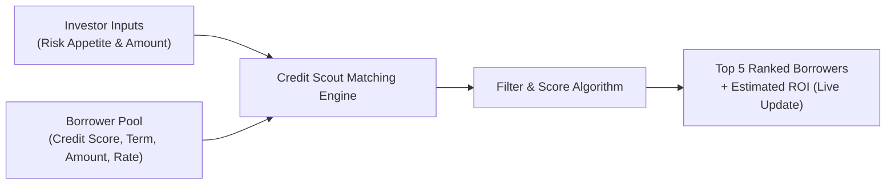

# Credit Scout 🎯

> **Automated Peer-to-Peer Micro-Lending Matchmaker**  
> Intelligently connecting micro-lenders with high-affinity borrowers in real time.

---

## 📌 Problem Statement

Investors find it hard to choose the right borrowers in peer-to-peer micro-lending, because every investor has a different risk appetite and investment amount, and manual matching is slow and inconsistent.

---

## 💡 Our Solution

**Credit Scout** is an automated matchmaker that ranks borrowers based on an investor's risk appetite and investment amount. It shows the top 5 borrowers with their estimated ROI, and updates live as soon as the investor changes either input.

---

## ✨ Features

- **🔄 Dual-Role Marketplace:** One-click toggle between **Lender (Investor) Mode** and **Borrower (Loan Applicant) Mode** within the same seamless platform.
- **⚡ Live Dynamic Matching:** Instant recalculation and re-ranking of borrower recommendations as soon as risk appetite or investment amount sliders change.
- **🎯 Top 5 Ranked Recommendations:** Surfaces the 5 best-suited borrower profiles tailored to the investor's specific constraints and lending strategy.
- **📈 Estimated ROI Calculation:** Calculates projected annual and net returns on investment (ROI) based on interest rates, loan terms, and risk adjustments.
- **📝 Instant Micro-Loan Application Portal:** Borrowers can apply for ₹10,000 to ₹5,00,000 with real-time credit grade assessments and an interactive live EMI calculator.
- **🔔 Automated Monthly Installment (EMI) Reminders:** Configurable multi-channel alert schedule (WhatsApp, SMS, Email, In-App Push) dispatched 1, 3, 5, or 7 days prior to every month's due date, complete with calendar sync (.ics) and UPI AutoPay mandate integration.
- **🟢 Reverse Matchmaker & Investor Radar:** Connects loan applicants with active peer lenders ready to fund their tickets, showing real-time funding progress.
- **🛡️ Risk Appetite Customization:** Granular filtering across risk profiles (Conservative, Moderate, Aggressive) matched against borrower credit scores, loan history, and debt-to-income ratios.
- **💰 Budget-Aware Allocation:** Intelligently maps the investor's available capital against borrowers' requested loan amounts in Indian Rupees (₹ INR).
- **📊 Intuitive Borrower Insights:** Displays detailed borrower cards with credit tiers, loan purpose, term duration, requested amount, and payback schedules.
- **📱 Responsive & Accessible UI:** Clean, modern dashboard built for seamless desktop and mobile use with dedicated mobile quick docks.

---

## 🛠️ Tech Stack

### Frontend & UI
- **Framework:** [React 18](https://react.dev/) / [Next.js](https://nextjs.org/) (or [Vite](https://vitejs.dev/))
- **Language:** [TypeScript](https://www.typescriptlang.org/)
- **Styling:** [Tailwind CSS](https://tailwindcss.com/)
- **Icons & Components:** [Lucide React](https://lucide.dev/) / [shadcn/ui](https://ui.shadcn.com/)

### Core Logic & State Management
- **State Management:** React Hooks (`useState`, `useMemo`, `useCallback`) for sub-millisecond live updates
- **Matching & Scoring Engine:** Custom multi-factor ranking algorithm (Risk Affinity Score + Allocation Fit + ROI Projection)

---

## 🚀 How to Run

### Quick Start (Instant — Zero Install Needed)
Credit Scout is built to run immediately in any modern web browser:
1. Open the project folder `credit-scout`.
2. Double-click **`index.html`** or right-click and choose **Open with > Chrome / Edge / Firefox**.
3. The interactive matchmaker will launch instantly with full real-time capabilities!

---

### Alternative: Local Development Server

If you have [Node.js](https://nodejs.org/) or a local static server installed:

```bash
# Using npx serve
npx serve .

# Or using Python
python -m http.server 3000
```
Then visit `http://localhost:3000`.

---

### Building for Production

To create an optimized production build:

```bash
npm run build
npm run start
```

---

## 📐 How the Matching Engine Works



1. **Risk Fit:** Scores borrowers based on how closely their risk grade matches the investor's chosen risk appetite.
2. **Amount Feasibility:** Matches requested funding amounts with the investor's investment limit.
3. **Projected ROI:** Computes expected return accounting for potential default probability per risk tier.
4. **Live Re-ranking:** Results update immediately upon user interaction with zero page reloads.

---

## 📄 License

This project is licensed under the [MIT License](LICENSE).
